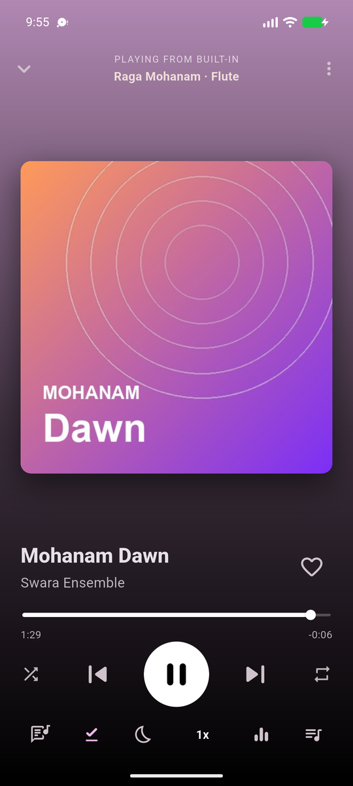
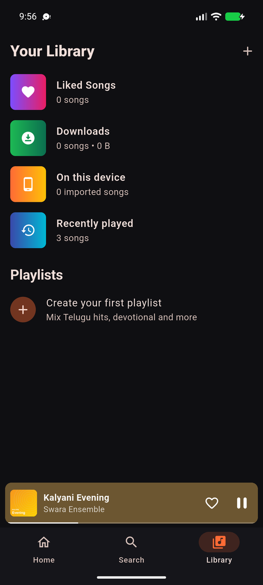

<h1 align="center">Swara — Telugu-first music player</h1>

<p align="center">
  Swara (స్వర) is a Flutter music app for Indian listeners, built around Telugu first.<br>
  It streams online and plays offline, with the features people expect from Spotify, Gaana and JioSaavn.
</p>

<p align="center">
  <a href="https://github.com/ChandraChaan/Swara/releases/latest"></a>
  <a href="https://github.com/ChandraChaan/Swara/actions/workflows/ci.yml"></a>
  
  <a href="LICENSE"></a>
</p>

<p align="center">
  
  
  
  
</p>

## Download

Get the latest APK from the **[Releases page](https://github.com/ChandraChaan/Swara/releases/latest)**.

| File | Use it if… |
| --- | --- |
| `Swara-vX.Y.Z-arm64-v8a.apk` | You have a modern phone (most Android phones from 2017 on). **Start here.** |
| `Swara-vX.Y.Z-armeabi-v7a.apk` | You have an older 32-bit phone. |
| `Swara-vX.Y.Z-x86_64.apk` | You are running an emulator or a Chromebook. |
| `Swara-vX.Y.Z-universal.apk` | You are unsure. It works everywhere but is larger. |

On your phone, open the APK and allow **Install unknown apps** when Android asks. Swara needs Android 7.0 or newer. New versions install over old ones and keep your library.

## Features

**Listen online**
- Telugu-first home feed: Trending in Telugu, Tollywood hits, film classics,
  Bhakti/devotional, Annamacharya keerthanalu, folk, Carnatic, Ghantasala's
  golden era, Telugu lo-fi.
- Supports Telugu, Hindi, Tamil, Kannada, Malayalam, Punjabi, Bengali, Marathi
  and English. Switch languages with one tap; pick extra languages in
  Settings.
- Personalised rows ("More like <your top artist>") built from your listening
  history.
- Search across every source at once with debouncing, recent searches and
  mood/genre tiles. Results are grouped into songs and albums/playlists.

**Listen offline**
- Download single songs, whole albums or playlists. Files and artwork are
  saved in private app storage. Downloads show progress and can be cancelled
  or retried.
- Import MP3s already on your phone (for example a Telugu collection). Their
  tags and cover art are read automatically.
- Ten original raga tracks are built in, so the app plays something even on
  first launch with no internet (see [Built-in music](#built-in-music)).
- Goes offline automatically when the connection drops, or turn on Offline
  mode to save data. Songs you can't play offline are dimmed and skipped
  cleanly.
- Search works offline too: it covers downloads, device songs, liked songs
  and history.

**The player**
- Background playback with notification, lock screen, headset, Bluetooth and
  car controls (via `audio_service`). Pauses on calls and when headphones are
  unplugged.
- Full-screen player whose colours follow the album art. Swipe the artwork to
  change songs, swipe down to close.
- Time-synced lyrics from LRCLIB. They scroll with the song, and tapping a line
  jumps to it.
- Queue: play next, add to queue, drag to reorder, swipe to remove.
- Shuffle, repeat all/one, and "previous" restarts the song after 3 seconds,
  like the big apps.
- Sleep timer (minutes or end of song) with a gentle fade-out.
- Playback speed from 0.5× to 2×.
- 5-band equalizer with presets (Bass boost, Vocal/Telugu melody, Mass beats,
  Carnatic…) and loudness boost. Android only.
- Gapless queue playback. Your last queue and position come back when you
  reopen the app.

**Library**
- Liked Songs, Downloads (with storage used), On this device, Recently played.
- Your own playlists: create, rename, reorder, delete, and add whole albums at
  once.
- Share songs. Dark/light/auto theme with six accent colours.
- Settings › About shows the app version and links to the source code, new
  releases and the issue tracker.

## Music sources

| Source | What it adds | Why |
| --- | --- | --- |
| [Audius](https://audius.org) | Modern, independent Telugu and Indian tracks and playlists | Open API that allows third-party streaming |
| [Internet Archive](https://archive.org) | Huge library of Telugu devotional, Carnatic, folk and old film albums | Public library with an open API |
| Your phone | Any MP3/M4A you import | Your own files |
| Built-in | 10 original raga tracks in `assets/audio` | Works on first launch, free to redistribute |

New releases from big labels (T-Series, Aditya Music, Lahari, Sony…) need a
licensed catalog, the same deal Spotify and Gaana sign. The app is built for
that. Implement `MusicSource` (`lib/data/sources/music_source.dart`) for a
licensed API and register it in `CatalogRepository`. Everything else
(downloads, queue, lyrics, offline) works with it unchanged.

## Built-in music

The bundled tracks are **original and synthesized from code** by
[`tool/generate_tracks.py`](tool/generate_tracks.py). Each track has a tanpura
drone, a tabla theka (Keherwa or Dadra), and a flute, veena or santoor
improvising on a raga: a slow free alaap first, then rhythmic phrases. The
audio and cover art are public domain
([CC0](https://creativecommons.org/publicdomain/zero/1.0/)).

| Track | Raga | Instrument | Tala |
| --- | --- | --- | --- |
| Mohanam Dawn | Mohanam | Flute | Keherwa |
| Hamsadhwani Flight | Hamsadhwani | Veena | Keherwa |
| Kalyani Evening | Kalyani | Santoor | Dadra |
| Shivaranjani Rain | Shivaranjani | Flute | Dadra |
| Hindolam Moon | Hindolam | Veena | Keherwa |
| Bhairavi River | Bhairavi | Santoor | Keherwa |
| Abhogi Lanterns | Abhogi | Flute | Keherwa |
| Madhyamavati Breeze | Madhyamavati | Veena | Dadra |
| Charukesi Dusk | Charukesi | Santoor | Dadra |
| Kharaharapriya Festival | Kharaharapriya | Veena | Keherwa |

To regenerate them (needs `ffmpeg` on your PATH):

```bash
python3 -m venv .venv && .venv/bin/pip install numpy pillow
.venv/bin/python tool/generate_tracks.py
```

To bundle your own song, add the `.mp3` to `assets/audio/`, a square `.jpg`
to `assets/artwork/`, and a `Song` entry to `CatalogRepository.bundled`. Only
bundle music you have the rights to distribute.

## Project layout

```
lib/
  core/        theme, formatting, languages and home-feed curation
  models/      Song, SongCollection, UserPlaylist, Lyrics
  data/        catalog sources, LibraryStore (Hive), lyrics
  services/    audio engine + audio_service handler, PlayerController,
               downloads, connectivity, settings, device import
  ui/          shell (tabs + mini player), screens, widgets
test/          unit + widget tests (fake audio engine, mocked HTTP)
tool/          generate_tracks.py for the built-in music and artwork
```

## Build from source

Requires Flutter 3.47+ (Dart 3.13+) and JDK 17.

```bash
git clone https://github.com/ChandraChaan/Swara.git
cd Swara
flutter pub get
flutter run            # Android or iOS device/emulator
flutter test           # 46 tests
flutter analyze
```

Build release APKs:

```bash
flutter build apk --release --split-per-abi
```

Release builds are signed with the key described in `android/key.properties`
(never committed):

```properties
storeFile=/absolute/path/to/swara-release.jks
storePassword=…
keyAlias=swara
keyPassword=…
```

Without that file, release builds fall back to the debug key. Every release
must be signed with the same key, or Android won't install it over an older
version.

## Contributing

Issues and pull requests are welcome. Please run `dart format`,
`flutter analyze` and `flutter test` before you open a PR. CI runs all three.

## License

The code is under the [MIT License](LICENSE). The built-in audio and artwork
are [CC0](https://creativecommons.org/publicdomain/zero/1.0/). Streamed songs
belong to their respective artists and labels.
