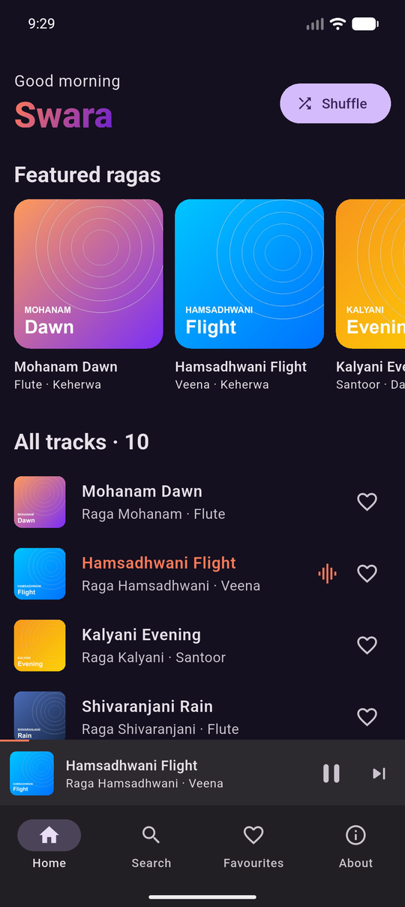
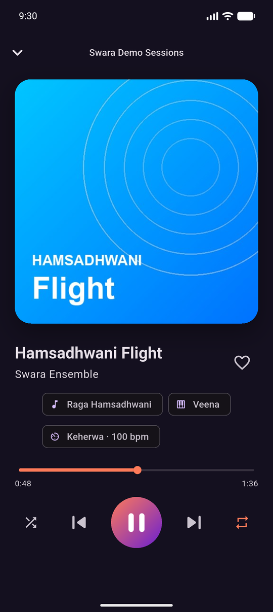
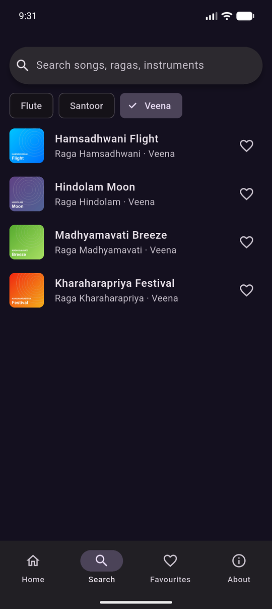
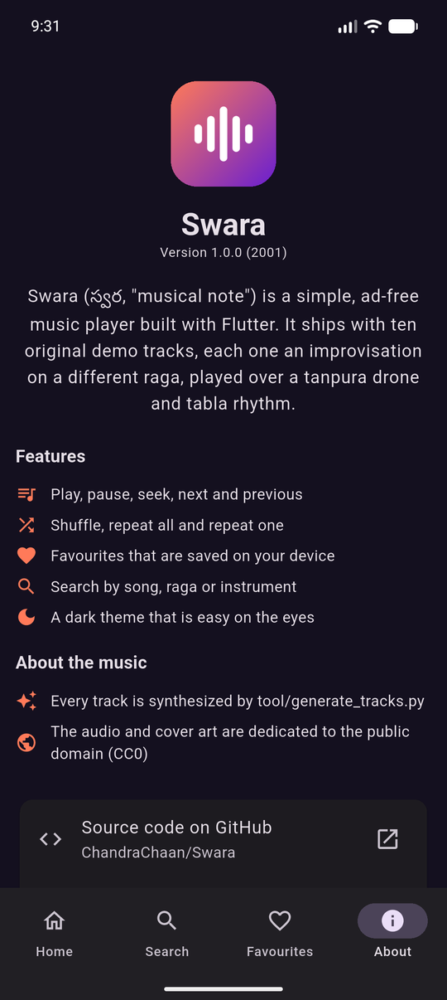

<p align="center">
  
</p>

<h1 align="center">Swara</h1>

<p align="center">
  A clean, ad-free music player for Android, built with Flutter.<br>
  Ships with ten original tracks, each one an improvisation on an Indian classical raga.
</p>

<p align="center">
  <a href="https://github.com/ChandraChaan/Swara/releases/latest"></a>
  <a href="https://github.com/ChandraChaan/Swara/actions/workflows/ci.yml"></a>
  
  <a href="LICENSE"></a>
</p>

<p align="center">
  
  
  
  
</p>

## Download

Get the latest APK from the **[Releases page](https://github.com/ChandraChaan/Swara/releases/latest)**.

| File | Use it if… |
| --- | --- |
| `Swara-vX.Y.Z-arm64-v8a.apk` | You have a modern phone (most Android phones from 2017 on). **Start here.** |
| `Swara-vX.Y.Z-armeabi-v7a.apk` | You have an older 32-bit phone. |
| `Swara-vX.Y.Z-x86_64.apk` | You are running an emulator or a Chromebook. |
| `Swara-vX.Y.Z-universal.apk` | You are unsure. It works everywhere but is larger. |

On your phone, open the APK and allow **Install unknown apps** for your browser or file manager when Android asks. Swara needs Android 7.0 or newer.

## Features

- 🎵 **Full player**: play, pause, seek, next and previous, plus a mini player docked above the tabs
- 🔀 **Shuffle and repeat** (off, all, or one)
- ❤️ **Favourites**, saved on your device
- 🔍 **Search** by song, raga or instrument, with instrument filter chips
- 🌙 **Dark Material 3 design** with album art for every track
- ℹ️ **About screen** with version info, open-source licences and links to report bugs

## The music

Every bundled track is **original and synthesized from code** by [`tool/generate_tracks.py`](tool/generate_tracks.py). Each track has a tanpura drone, a tabla theka (Keherwa or Dadra), and a flute, veena or santoor improvising on a raga: a slow free alaap first, then rhythmic phrases.

| # | Track | Raga | Instrument | Tala |
| --- | --- | --- | --- | --- |
| 1 | Mohanam Dawn | Mohanam | Flute | Keherwa |
| 2 | Hamsadhwani Flight | Hamsadhwani | Veena | Keherwa |
| 3 | Kalyani Evening | Kalyani | Santoor | Dadra |
| 4 | Shivaranjani Rain | Shivaranjani | Flute | Dadra |
| 5 | Hindolam Moon | Hindolam | Veena | Keherwa |
| 6 | Bhairavi River | Bhairavi | Santoor | Keherwa |
| 7 | Abhogi Lanterns | Abhogi | Flute | Keherwa |
| 8 | Madhyamavati Breeze | Madhyamavati | Veena | Dadra |
| 9 | Charukesi Dusk | Charukesi | Santoor | Dadra |
| 10 | Kharaharapriya Festival | Kharaharapriya | Veena | Keherwa |

The audio and cover art are public domain (CC0), so you can reuse them freely.

### Add your own songs

1. Put an `.mp3` in `assets/audio/` and a square `.jpg` cover in `assets/covers/`.
2. Add an entry to [`assets/catalog.json`](assets/catalog.json).
3. Rebuild the app.

Only bundle music you have the rights to distribute.

## Build from source

You need [Flutter](https://docs.flutter.dev/get-started/install) 3.44 or newer and JDK 17.

```bash
git clone https://github.com/ChandraChaan/Swara.git
cd Swara
flutter pub get
flutter run
```

Run the checks:

```bash
flutter analyze && flutter test
```

Build release APKs:

```bash
flutter build apk --release --split-per-abi
```

Release builds are signed with the key described in `android/key.properties` (not committed):

```properties
storeFile=/absolute/path/to/swara-release.jks
storePassword=…
keyAlias=swara
keyPassword=…
```

Without that file, release builds fall back to the debug key.

Regenerate the bundled tracks, covers and icon:

```bash
python3 -m venv .venv && .venv/bin/pip install numpy pillow
.venv/bin/python tool/generate_tracks.py   # needs ffmpeg on PATH
dart run flutter_launcher_icons
```

## Project structure

```
lib/
├── main.dart                  # App entry, loads the catalog
├── theme.dart                 # Colours, gradient, Material 3 theme
├── models/track.dart          # Track model + catalog loader
├── player/player_controller.dart  # Queue, playback, shuffle/repeat, favourites
├── screens/                   # Home, Search, Favourites, Now Playing, About
└── widgets/track_widgets.dart # Cover art, track tile, mini player
assets/                        # catalog.json, audio, covers, icon
tool/generate_tracks.py        # Synthesizes the bundled music and artwork
```

## Contributing

Issues and pull requests are welcome. Please run `dart format`, `flutter analyze` and `flutter test` before you open a PR.

## License

The code is under the [MIT License](LICENSE). The bundled audio and artwork are [CC0](https://creativecommons.org/publicdomain/zero/1.0/).
